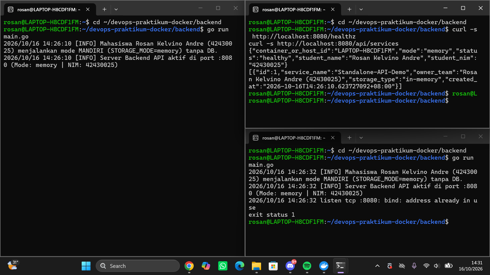
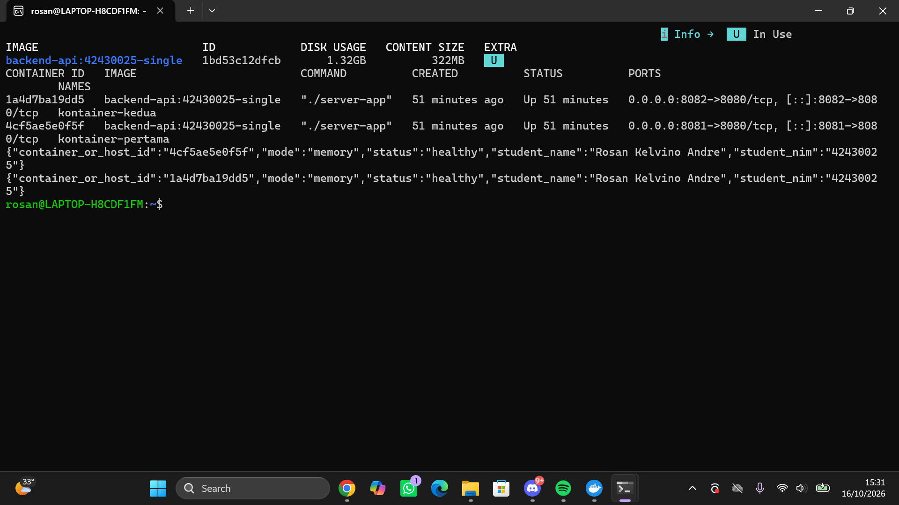
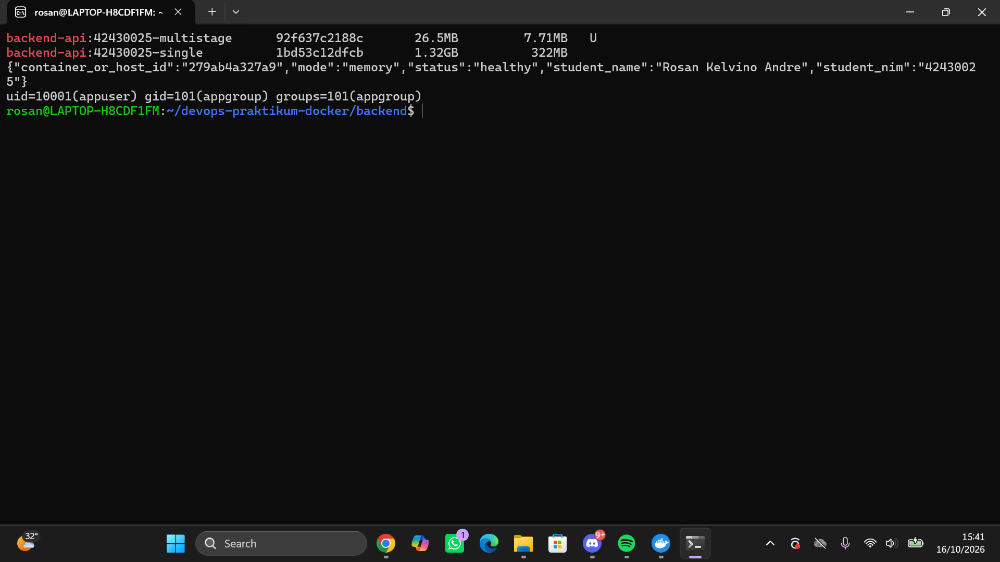
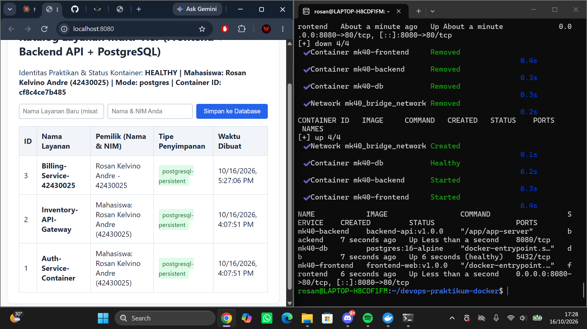
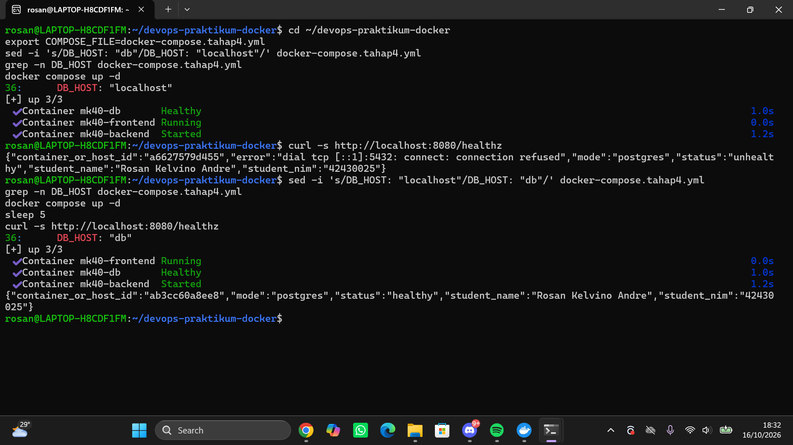
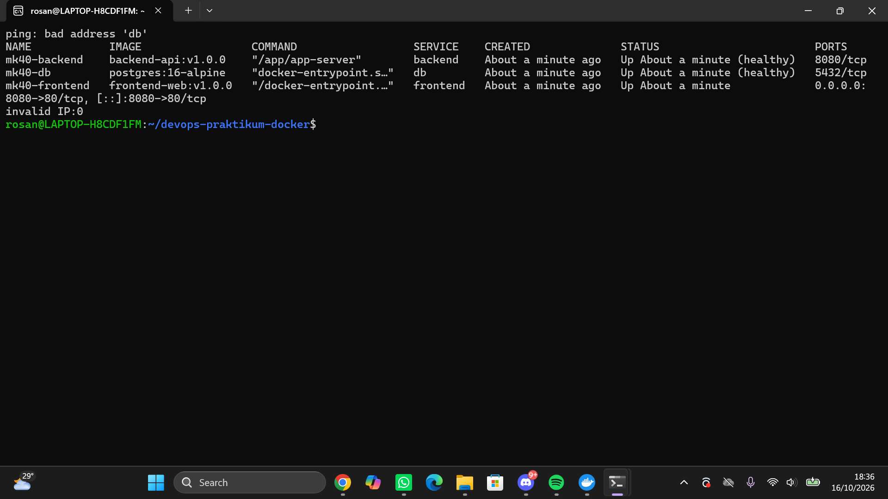

# Laporan Praktikum Modul 1 (Pertemuan 4): Kontainerisasi Docker & Orkestrasi Multi-Tier (Lab 1 & Lab 2)

- **Nama Mahasiswa**: [Isi Nama Lengkap Anda]
- **NIM**: [Isi NIM Anda]
- **Kelas / Prodi**: S1 Teknologi Informasi – UNDIKNAS Denpasar
- **Tautan Branch / Pull Request GitHub**: [Isi URL Branch / PR Anda]
- **Nama Rekan Peer-Reviewer**: [Isi Nama & NIM Rekan yang Me-review PR Anda]

---

## 1. Tabel Komparasi Eksperimen Individu (Tahap 1 vs. Tahap 2 vs. Tahap 3)

| Parameter Pembanding | Tahap 1: Tanpa Docker (Native di Host OS) | Tahap 2: Docker Single-Stage (`Dockerfile.single`) | Tahap 3: Docker Multi-Stage (`Dockerfile`) |
| :--- | :--- | :--- | :--- |
| **Kebutuhan Instalasi Go di Host** | Wajib instal Go SDK di laptop | Tidak wajib (cukup Docker) | Tidak wajib (cukup Docker) |
| **Ukuran Image (`docker images`)** | *Tidak menghasilkan image* | `... MB` | **`... MB`** (Target < 100 MB) |
| **Output `container_or_host_id` & NIM** | Hostname: `...` \| NIM: `...` | Container ID: `...` \| NIM: `...` | Container ID: `...` \| NIM: `...` |
| **User Eksekusi Proses (`id`)** | User laptop saat ini | `uid=0 (root)` | `uid=10001 (appuser)` |
| **Menjalankan 2 Instansi Sekaligus** | Gagal jika port sama | Berhasil (`-p 8081:8080` & `8082:8080`) | Berhasil (`-p`) |

> Isi tanda `...` dengan hasil dari komputer Anda sendiri.

---

## 2. Bukti Screenshot & Penjelasan Analisis Setiap Tahapan

### A. Tahap 1 – Eksekusi Aplikasi Mandiri Tanpa Docker (Baseline)

**Penjelasan Analisis Tahap 1**:

Nilai `container_or_host_id` berasal dari `os.Hostname()`. Karena aplikasi berjalan langsung di Host OS (tanpa isolasi namespace `uts`), hostname yang terbaca adalah nama laptop saya: `[isi hostname Anda]`. Aplikasi juga hanya bisa dijalankan karena Go SDK sudah terpasang di host (`go version` = `[isi]`), sehingga komputer lain tanpa Go tidak bisa menjalankannya.

Instansi kedua gagal dengan `listen tcp :8080: bind: address already in use` karena tanpa isolasi jaringan, semua proses di host berbagi satu ruang port yang sama. Port 8080 sudah di-*bind* oleh instansi pertama, dan satu port hanya dapat dipakai satu proses pada satu alamat.

### B. Tahap 2 – Kontainer Tunggal dengan Single-Stage Dockerfile

**Penjelasan Analisis Tahap 2**:

Di dalam kontainer, hostname otomatis berisi Container ID (`[isi ID 1]` dan `[isi ID 2]`) karena setiap kontainer punya namespace `uts` sendiri. Dua kontainer dari satu image dapat berjalan bersamaan karena masing-masing punya namespace `net` sendiri; keduanya sama-sama mendengarkan port 8080 *di dalam* kontainer. Yang berbeda adalah pemetaan di sisi host: `-p 8081:8080` dan `-p 8082:8080` memetakan port host berbeda ke port 8080 masing-masing kontainer, sehingga tidak bentrok.

Ukuran image membengkak (`[isi] MB`) karena base image `golang:1.22-bookworm` memuat OS Debian lengkap, compiler Go, toolchain, dan package manager, ditambah source code dan cache build yang ikut terbawa ke image akhir padahal hanya binary yang dibutuhkan saat runtime.

### C. Tahap 3 (Lab 1) – Optimasi Dockerfile Multi-Stage Build (< 100 MB)

**Penjelasan Analisis Tahap 3**:

Penghematan ukuran = (ukuran single − ukuran multistage) / ukuran single × 100%
= ([isi] − [isi]) / [isi] × 100% = **[isi]%**.
(Contoh perhitungan dengan angka modul: (840 − 16) / 840 ≈ 98%. Gunakan angka asli Anda.)

`COPY --from=builder` menyalin hanya file biner `/build/app-server` dari stage `builder` ke stage `production`. Seluruh compiler, source code, dan cache build tertinggal di stage 1 dan tidak ikut ke image akhir, sehingga image hanya berisi Alpine (~7 MB) plus binary. Salinan `go.mod`/`go.sum` lebih dulu dan `go mod download` dipisah menjadi layer sendiri: selama dependensi tidak berubah, Docker memakai cache layer tersebut dan tidak mengunduh ulang library ketika hanya `main.go` yang diubah.

`USER appuser` (uid 10001) menjalankan aplikasi tanpa hak root. Bila aplikasi diretas atau terjadi *container escape*, penyerang tidak otomatis mendapat hak root, sehingga dampaknya lebih terbatas (prinsip *least privilege*).

### D. Tahap 4 (Lab 2) – Orkestrasi Multi-Tier & Persistensi Data dengan Docker Compose

**Penjelasan Analisis Tahap 4**:

Alur: browser → `frontend` (Nginx, port 8080 host → 80 kontainer) → *reverse proxy* `/api/` dan `/healthz` ke `http://backend:8080` → `backend` terhubung ke `db` lewat `DB_HOST=db`. Nama layanan (`backend`, `db`) di-resolve oleh DNS bawaan Docker pada *custom bridge network*. Service `db` tidak punya blok `ports:`, sehingga port 5432 hanya dapat dijangkau dari dalam jaringan Docker dan tidak terbuka ke host/publik.

Data PostgreSQL disimpan di named volume `mk40_pgdata_volume` (dipasang ke `/var/lib/postgresql/data`). Volume hidup terpisah dari siklus hidup kontainer: `docker compose down` menghapus kontainer dan jaringan, tetapi volume tetap ada. Setelah `docker compose up -d`, kontainer baru (Container ID berubah menjadi `[isi]`) memasang volume yang sama sehingga data `[nama layanan yang Anda input]` tetap muncul.

### E. Tahap 5 – Skenario Troubleshooting & Analisis Error

**Penjelasan Analisis Tahap 5**:

Setiap kontainer punya namespace `net` sendiri, sehingga `localhost` (127.0.0.1) di dalam kontainer `backend` menunjuk ke kontainer `backend` itu sendiri, bukan ke `db`. Di sana tidak ada PostgreSQL yang mendengarkan port 5432, sehingga muncul `dial tcp 127.0.0.1:5432: connect: connection refused` dan status `unhealthy`. Solusinya memakai nama layanan `db` yang di-resolve DNS Docker ke IP kontainer database.

`docker compose down -v` ikut **menghapus named volume**, sehingga seluruh data database hilang permanen dan `init.sql` dijalankan ulang dari nol pada `up` berikutnya. Karena itu `-v` berbahaya untuk data yang harus dipertahankan.

### F. Tantangan Mandiri – Dual Bridge Network, `.env`, dan Healthcheck Backend

**Penjelasan Analisis Tantangan Mandiri**:

Arsitektur: `frontend` hanya di `frontend-net`; `db` hanya di `backend-net`; `backend` di keduanya sebagai perantara. Karena `frontend` dan `db` tidak berbagi jaringan, DNS Docker tidak dapat me-resolve `db` dari `frontend`, sehingga `docker exec mk40-frontend ping -c 2 db` menghasilkan `bad address 'db'`. Aplikasi web tetap normal karena frontend hanya perlu menjangkau `backend`, dan `backend` yang berbicara ke `db`. `docker compose port db 5432` kosong, membuktikan port DB tidak dipublikasikan.

Kredensial (password DB, NIM, nama) dipindah ke `.env` yang masuk `.gitignore`, sehingga tidak ikut ter-commit ke GitHub. Di repositori hanya ada `.env.example` berisi contoh tanpa password asli, dan `docker-compose.yml` hanya memuat referensi `${NAMA_VARIABEL}`. Healthcheck backend memakai `wget --spider -q http://localhost:8080/healthz`, dan `frontend` memakai `depends_on: condition: service_healthy` agar baru start setelah backend sehat.

---

## 3. Bukti Audit Silang (Peer-Review) di GitHub
- **Tautan Pull Request (PR)**: `https://github.com/.../pull/...`
- **Ringkasan Catatan Peer-Reviewer**: [Tuliskan hasil verifikasi dari rekan yang memeriksa PR Anda]
